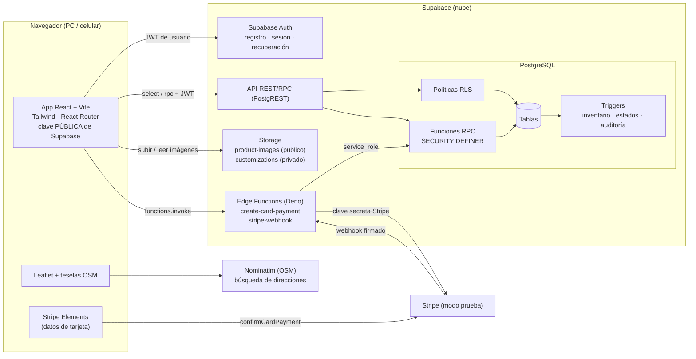
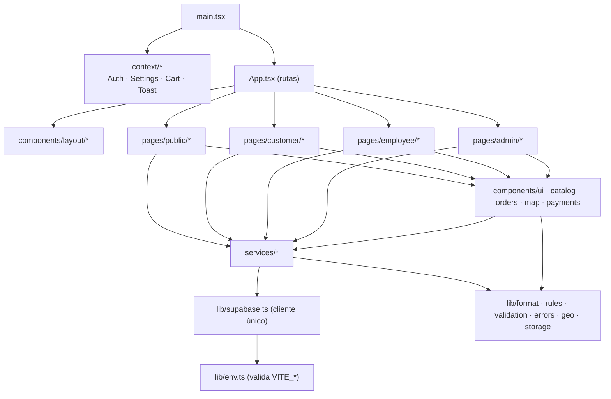
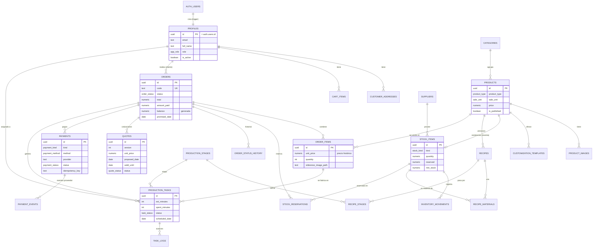
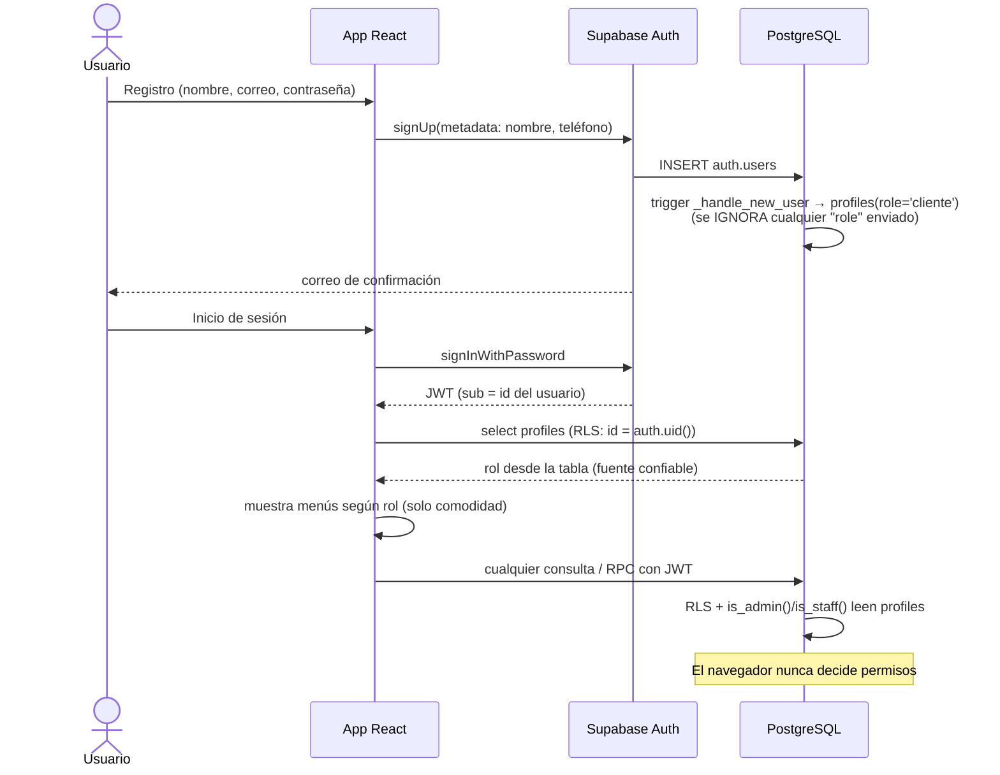
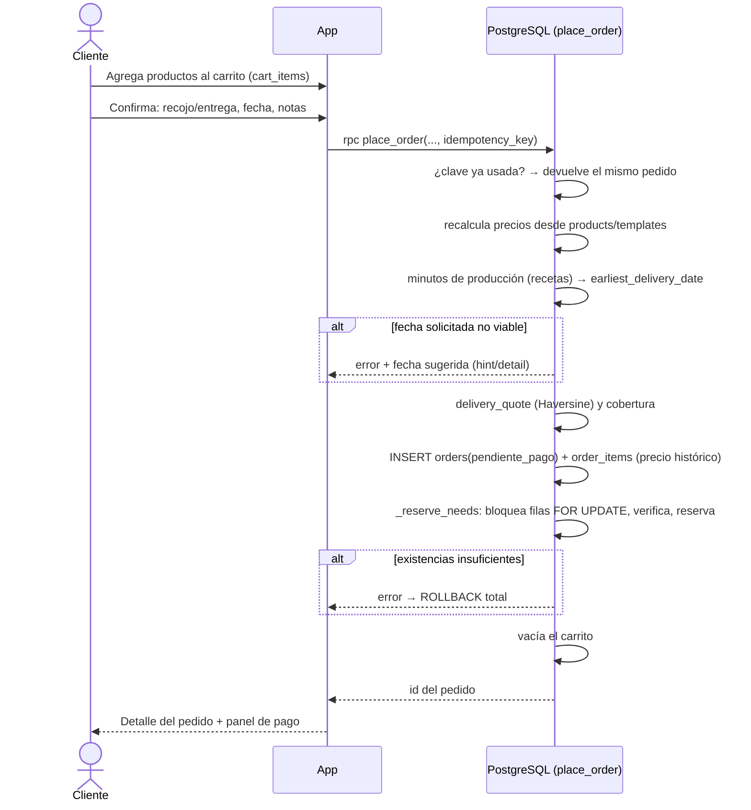
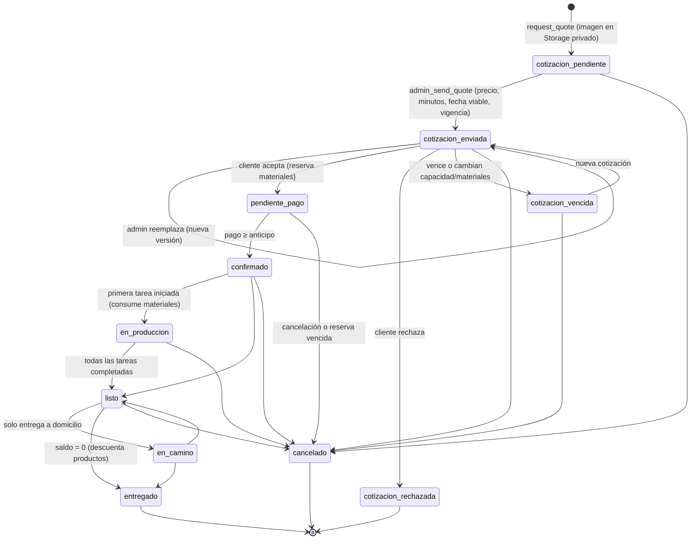
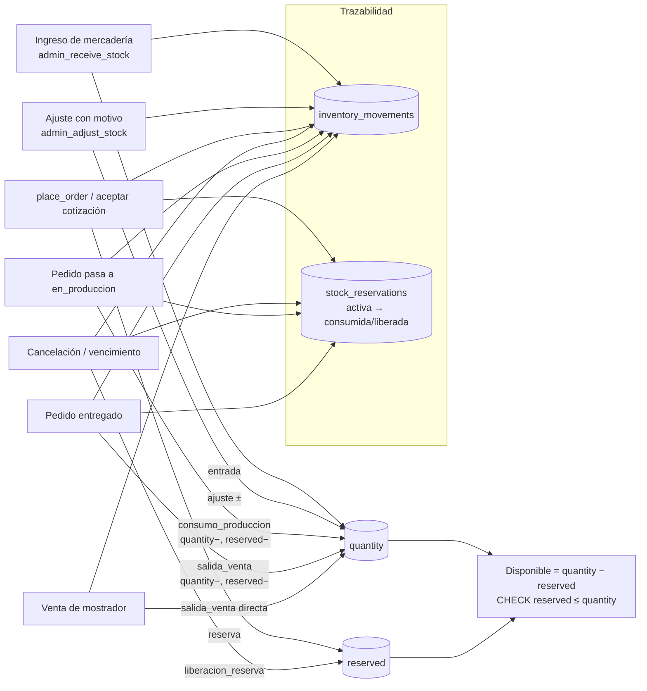
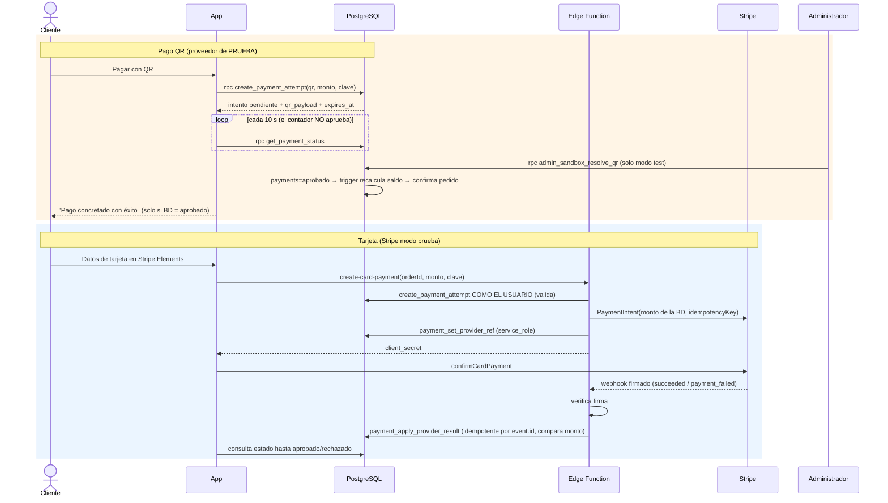

# Diagramas del sistema Cotillón MiraLiz

Todos los diagramas están en **Mermaid** (texto reproducible). GitHub los dibuja automáticamente; también pueden verse en <https://mermaid.live> o en VS Code con la extensión "Markdown Preview Mermaid Support".

## 1. Arquitectura general

## 2. Estructura lógica de módulos (frontend)

## 3. Modelo de datos (relaciones principales)

Tablas de soporte no dibujadas: `app_settings` (parámetros), `audit_log` (auditoría).

## 4. Autenticación y autorización

## 5. Flujo de compra (catálogo → pedido)

## 6. Cotización con diseño propio

Las transiciones las impone el trigger `orders_before_status` con `order_transition_allowed`, sin importar desde dónde se intente el cambio.

## 7. Inventario y producción

Capacidad: `earliest_delivery_date(minutos)` suma la carga abierta (tareas no completadas + pedidos en espera de pago) y recorre los días acumulando `minutes_by_weekday` hasta cubrirla.

## 8. Pago y confirmación

